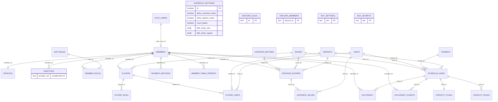

## 13.11.2026 — сохранённая версия инструкции API (подготовлено)

Миграция20261113010000_external_api_guide_version добавляет clients.guide_version (1/2, для прежнихключей1). RootRPC явно принимает и возвращает это поле; права ключа, authorize и протокол API не меняются. Это предпочтение адреса/инструкции, не запрет другой версии API. Некорректнаяверсия отклоняется, повторcreate не перезаписывает существующуюнастройку. НовыйUI явно передаётвыборv2поумолчанию.

## 13.11.2026 — приоритет игроков API v2 (опубликован)

Добавочная миграция `20261112221205_external_api_v2_priority.sql` переиспользует активный кэш Nitro50–100. Закрытые prepare_priority/read_priority доступны толькоservice_role; авторизация ключа предшествует прогреву. Грязный кэш штатно обновляется, чистый не пересчитывается. read_sync остаётсяSTABLE: вектор содержит ревизию расчёта, per-person priority и порядок участвуют в хеше справочника. Изменения рейтинга дают person-дельты без клеток; старые курсоры получают новые поля без смены эпохи. Неизменные страницы сохраняются. Новый вход/лимиты/данные смен не меняются.

# База schedule-app

## External API v2 — локальная миграция 12 ноября 2026

`20261112212201_external_api_v2.sql` расширяет существующий `notify_slots`: после транзакционного `bump_version` сохраняется один маркер на `(kind_id,slot_date,half,level)` в `external_api_private.cell_changes`. FK на occupancy/kind намеренно нет: удаление адреса должно оставлять маркер. Текущее состояние читается из occupancy, оба прежних Broadcast сохраняются. Конфигурационные изменения требуют resync; изменения людей дают отдельные записи справочника.

`read_sync` (STABLE, invoker) согласованно читает версии/данные; неизменный вектор обрабатывается без occupancy. `external_api_sync` — закрытая RPC только service_role с прежним `schedule:read`, квотой и привязкой курсора к клиенту. `sync_states` хранят query/вектор/хеши людей24h, `sync_batches`/`sync_pages` — неизменный пакет15min,1000элементов на страницу, финальный sync cursor только на последней. В закрытых таблицах RLS, anon/authenticated доступа не имеют. До600состояний и64MiB на состояния/64MiB на пакеты ключа. Маркеры старше30дней очищает часовой cron; эпоха меняется в той же транзакции, старые курсоры получают410. Наивный sequence watermark и обычный аудит не используются. В Working пока не применено. [Контракт](../supabase/functions/external-api/V2-SYNC.md).

## Событийный контракт Preview — 7 ноября2026

Новая совместимая миграция добавляет `load_schedule_snapshot_v2`, `load_schedule_versions`, `load_schedule_configuration`, `save_schedule_sync` и `apply_schedule_edit_v2`. Закрытые `schedule_private.sync_versions/edit_receipts`, атомарное сравнение клеток/квитанция UUID; каналы `app:changes` и legacy `schedule:changes` работают совместно. RLS разрешает активным участникам получение минимальных событий и публикацию только Presence, клиентский Broadcast запрещён. [Полный контракт](schedule-data-sync.md).

## Root-журнал (локальная миграция, 7 ноября 2026)

[Миграция root_logs](../supabase/migrations/20261106225025_root_logs.sql) добавляет две RPC с пустым search_path, явной проверкой auth.uid()/is_root(), без EXECUTE для PUBLIC/anon:

- `root_logs(source, person, role, from, to, action, limit, before_at, before_id)` читает существующие occupancy_events или member_distance_id_audit. Максимум 200 записей, keyset-переход по `(at,id)` без OFFSET. Даты включительны в Europe/Minsk, UUID и bigint курсоры сравниваются в родных типах. Поиск подстроки по текущим именам/Discord/ID, `%` не является шаблоном. Автор и участник фильтруются независимо. LEFT JOIN сохраняет события удалённых карточек; старые FK occupancy_events уже могли стать NULL — восстановить автора по ним нельзя. Email/телефон/прочие частные поля не возвращаются.
- `root_logs_cleanup(months, cutoff, confirm)` принимает только 2/3 месяца. Предпросмотр возвращает границу и количество. Подтверждение требует ту же допустимую границу, не старее 15 минут, и удаляет только occupancy_events с `at < cutoff`, до 5000 строк, с SKIP LOCKED. Возвращает удалённое/оставшееся количество. История ID, факты дистанций и само расписание не затрагиваются. Операция транзакционная; при неоднозначном сетевом результате пользователь заново получает подсчёт.

У occupancy_events узкий индекс по at заменён `(at DESC,id DESC)`, совместимым с автоматической очисткой; у member_distance_id_audit добавлен такой же индекс. Существующие actor/member индексы сохраняются. Прежний cron `occupancy-events-prune` и функция хранения 2 месяца не меняются. [SQL-контракт](../supabase/tests/root_logs.sql) проверяет права, даты, курсоры одинакового времени, поиск, удалённые карточки, строгую границу и размер порции очистки.

Доработка5 ноября2026, миграция применена к Working перед тестовым выпуском: миграция [20261105102935](../supabase/migrations/20261105102935_active_priority_selection.sql) добавляет закрытую RLS-таблицу priority_settings(id=true, active_period=2026-08-01, revision=0). set_active_priority(date,bigint) — admin.people/root и auth.uid, проверка даты и ожидаемого счётчика под FOR UPDATE; load_priority_view(date,text,text,boolean) — прежние права чтения, null выбирает активный период и возвращает activePeriod/activeRevision/canActivate; load_active_month_roster(text,text,text[],text,text) — schedule, период определяется сервером. Чтения удерживают FOR SHARE настройки и переиспользуют существующие RPC/кэш, прямые права на таблицу отсутствуют. Старые функции сохранены. Контракт: [active_priority.sql](../supabase/tests/active_priority.sql).

## Оформление закрытой ёмкости — 5 ноября 2026

Миграция [20261105093758_locked_slot_appearance.sql](../supabase/migrations/20261105093758_locked_slot_appearance.sql), применена в Working 5 ноября 2026: `schedule_settings.locked_slot_appearance` — обязательный JSON `{light,dark,short,long,merge}`. Строгая проверка пяти ключей, цветов `#RRGGBB`, строк до 12/120 символов и boolean. Defaults: `#d5dbe4`, `#343e50`, пустые строки, merge=true.

`save_schedule_locked_appearance(p_appearance,p_expected)` проверяет auth.uid и актуальное `schedule.manage`, блокирует строку, сравнивает ожидаемое значение, меняет только новый столбец. Цвета приводятся к нижнему регистру; регистр описаний сохраняется. SECURITY DEFINER нужен для записи защищённой колонки, search_path пустой, PUBLIC/anon EXECUTE отозван, прямой UPDATE клиентам не выдан. Чтение — через существующую RLS schedule_settings; действующий триггер аудита сохраняет updated_by. [SQL-контракт](../supabase/tests/locked_slot_appearance.sql) проверяет запись/чтение, валидацию, отсутствие частичной записи, конфликт, root/обычный администратор/игрок/anon/отозванное право и неизменность других настроек. Occupancy не меняется.

## Фон будущих слотов (Working, 4 ноября 2026)

[Миграция](../supabase/migrations/20261104153303_slot_tint.sql) добавляет `schedule_settings.slot_tint`: ровно `{enabled: boolean, strength: integer 0..30}`, NOT NULL, по умолчанию `{enabled:true,strength:8}`, строгий CHECK. Новый RPC `save_schedule_appearance(p_palette,p_expected_palette,p_tint,p_expected_tint)` проверяет личность и `schedule.manage`, блокирует строку и сравнивает обе исходные версии перед единым UPDATE. Конфликт — `40001 / palette-conflict`, невалидный JSON — `22023`; прямой UPDATE и анонимный EXECUTE закрыты, search_path пустой. Чтение/RLS/аудит/Realtime прежние.

Старый `save_schedule_limit_palette` совместим и сохраняет только цвета, не затрагивая фон. [Контракт палитры](../supabase/tests/limit_palette.sql) расширен проверками общего сохранения, границ, некорректных типов, конфликтов обоих полей и прав. Миграция установлена в Working4 ноября2026. Транзакционный контракт записи/чтения/конфликтов/прав прошёл с rollback, прежние настройки сохранены.

## Компактное чтение и события расписания (Working/preview, 4 ноября 2026)

[Миграция](../supabase/migrations/20261104125706_compact_schedule_sync.sql) добавляет `load_schedule_snapshot(year, month, targets = null, directory_only = false) → jsonb`. Доступ — только авторизованным с `schedule` или `schedule.manage`; SECURITY DEFINER использует пустой search_path и явные схемы. `targets` — до 500 пар `{date, kind_id}` внутри выбранного месяца Winamax Nitro/Regular. `null` означает весь месяц, `[]` — пустой набор. При `directory_only` слоты не передаются, справочник включает владельцев выбранного набора.

Один SQL-срез возвращает `version:1`, период, каталог `kinds`, компактные `slots`, уникальных `members` и `slot_count`. Шесть полей слота: `kind_id, day, half, level, member_id, tables`; текущие буквы, цвета, Discord/Winamax-имена, аватар и приоритеты находятся в справочнике. Табличный max_rows не применяется к скалярному JSON. Защитные пределы — 100000 слотов и 16 MiB JSON: превышение явно завершает запрос ошибкой, без молчаливого усечения. Материализованного серверного кэша нет. `load_month_schedule` сохранена для старого опубликованного клиента.

Закрытая схема `schedule_private` содержит trigger-функции без клиентского EXECUTE. INSERT/UPDATE/DELETE `occupancy` отправляет через `realtime.send` private Broadcast `schedule:changes / slots` с `{date, kind_id}`; смена координат сообщает оба участка. Транзакция записи включает уведомление, откат не публикует изменение. В новой миграции семантические row-триггеры профилей/ников отправляют `directory`, без персональных данных; изменения только технических timestamps не публикуются. Одно событие на ключ/транзакцию; доступ инвалидируется отдельно от косметики. Политика `realtime.messages` разрешает только получение пользователям расписания, отправка клиентом не разрешена. Основные данные в любом случае перечитываются через защищённую RPC.

[SQL-контракт](../supabase/tests/compact_schedule.sql) проверяет более 1000 слотов, справочник без дублей, чтение/очистку участка, уведомление удаления, смену метки, недопустимый период, отсутствие права, anon и запрет подделки событий. Отдельный браузерный тест использует два настоящих локальных Auth-сеанса и Realtime. 4 ноября 2026 миграция установлена в Working, чтение/права и неизменность всех occupancy проверены; порядок выпуска — [operations.md](operations.md).

## Нагрузка по часам (опубликовано, 4 ноября 2026)

[Миграция](../supabase/migrations/20261104101829_schedule_hour_load.sql) добавляет `schedule_settings.hour_load` — JSON-объект с ключами `nitro:50`, `regular:50` и другими существующими номиналами. Значение — ровно 24 часа CET; каждый час содержит `null` либо ID одного из десяти оттенков. CSS-строки не принимаются. Отсутствующая пара равна пустой строке. CHECK использует `valid_hour_load` и `valid_hour_load_row`.

Запись — только `save_schedule_hour_load(p_key, p_row, p_expected)`: проверка личности и `schedule.manage`, блокировка строки, сравнение ожидаемых 24 значений выбранной пары, изменение только её ключа. Устаревшая запись возвращает `40001 / hour-load-conflict`; независимая правка другой пары не конфликтует. Невалидный ключ/строка — `22023`. Прямой UPDATE новой колонки и анонимный вызов закрыты, чтение использует существующую RLS, аудит — существующий trigger.

Старый браузерный `v2-hour-load` не является серверными данными; его импорт только явный. Миграция не меняет ёмкость, мёртвое время, каталог лимитов и игровые права. [SQL-контракт](../supabase/tests/hour_load.sql) проверяет изоляцию пар, конфликты, валидацию, доступ/отзыв права и сохранность других настроек.

## Палитра лимитов клуба (опубликовано, 4 ноября 2026)

[Миграция](../supabase/migrations/20261104095535_club_limit_palette.sql) добавляет `schedule_settings.limit_palette`: обязательный JSON из шести номиналов (5/25/50/100/250/500), каждый содержит ровно `light` и `dark` в формате `#RRGGBB`. CHECK и RPC используют строгую `valid_schedule_limit_palette`. Начальные покерные цвета согласованы с клиентом; доступность лимитов не меняется.

Существующая RLS разрешает чтение авторизованным пользователям. Прямого UPDATE нового поля нет; запись через `save_schedule_limit_palette(p_palette, p_expected)` либо новый общий RPC оформления (описан выше) с проверкой `auth.uid()` и `schedule.manage`, закрытым `search_path` и без анонимного EXECUTE. Функция блокирует строку, сравнивает предыдущую палитру и при несовпадении возвращает `40001 / palette-conflict`. Невалидный JSON возвращает `22023`. HEX нормализуется к нижнему регистру. Существующий trigger обновляет автора и время; остальные настройки не меняются.

Realtime использует уже опубликованную `schedule_settings`. [SQL-контракт](../supabase/tests/limit_palette.sql) проверяет доступ, формат, атомарность и конфликты в транзакции с откатом; включён в CI. 4 ноября2026 миграции палитры и нагрузки применены к Working; облачные SQL-проверки с rollback прошли. [Выпуск](../memory/tasks/2026-11-04-schedule-release.md).

Одна база: **Postgres в Supabase** (проект `wvfllegshaqonqqpbtle`, EU). Не несколько баз — несколько таблиц в одной. Discord — внешний сервис, не наша таблица. Вход (`auth.users`) — схема Auth **того же** проекта.

Сверку живой схемы делали **22 сентября 2026**. Интерактивная схема с перетаскиванием таблиц — Canvas «Схема базы» рядом с чатом в Cursor. SQL: [`../supabase/migrations`](../supabase/migrations). Сид справочников: [`../supabase/seed.sql`](../supabase/seed.sql). Смысл сущностей: [модель данных](domain-model.md).

## Внешний API — локальная миграция 3 ноября 2026

[`20261103160348_external_api.sql`](../supabase/migrations/20261103160348_external_api.sql) создаёт закрытую схему `external_api_private`: `clients` хранит SHA-256 ключа, scopes, срок/отзыв и минутную квоту, `failed_auth` — один ограниченный счётчик неверных ключей. Обе таблицы с RLS, без доступа PUBLIC/anon/authenticated; схема не добавляется в Data API. Внутренняя RPC `public.external_api_schedule(text,text,integer,text,text,text)` — SECURITY INVOKER, EXECUTE только service_role. Источником расписания остаётся occupancy + имена/метка; права записи и Discord-вход сохранены.

Следующая локальная миграция [`20261103165923_external_api_snapshot_pages.sql`](../supabase/migrations/20261103165923_external_api_snapshot_pages.sql) заменяет RPC без неоднозначных перегрузок и добавляет приватные `snapshots`/`snapshot_pages` (RLS, закрытые grants). Первый запрос читает1–31 день одним SQL-срезом и фиксирует все поля; выдача по1000 записей, продолжение по непрозрачному cursor только для того же ключа. Каждая страница повторно проверяет ключ/права/квоту. TTL15мин, cron5мин удаляет истёкшие данные каскадно; срок проверяется до выдачи. Ошибка410 одинакова для недоступного/истёкшего/чужого курсора. Лимиты250000 меток/128 MiB на снимок,30 живых снимков/256 MiB на ключ и4 MiB сырой страницы ограничивают хранение; неудачная сборка откатывает весь снимок. Обе миграции применены только к выделенным локальным Supabase, **не к Working**. [Контракт и запуск](../supabase/functions/external-api/README.md), [SQL-проверки](../supabase/tests/external_api.sql), [проверка неизменности/доступа/очистки снимка](../supabase/tests/external_api_pagination.sql).

## Где лежит то, что видно на экране

| На экране | Таблица | Ключ |
|---|---|---|
| Человек клуба (карточка, заявка, апрув) | `members` | `id` uuid. Не Discord ID |
| Короткий код (ID в клубе) | `members.public_code` | `RP-` + 6 знаков. Виден админу в карточке человека, **в кабинете нет**. Не Discord ID |
| ID участника в дистанциях | `members.distance_ext_id` | Цифры из внешнего сервиса рук. Уникален, если задан. Пишет SQL `is_staff()` (admin/root). В кабинете не показываем |
| Тип | `members.community_status` | `school` = Training, `club` = RedParty. На экране названия английские. Подпись поля — «тип» |
| Поручитель | `members.guarantor_id` | Другой `members`. Пишет SQL `is_staff()` (admin/root), в кабинете нет |
| Вход в приложение | `auth.users` → `members.auth_user_id` | uuid сессии Supabase |
| Метка на сетке (YO, цвета) | поля `members`: `mark_tag`, `mark_bg`, `mark_fg` | В профиле может отсутствовать; для нового слота обязательно непустое значение. Если есть — уникальна без учёта регистра. Буквы система не резервирует. Отдельной таблицы меток нет |
| Последнее число столов в окне правки | `members.tables` | 1–30. Кисть по умолчанию, не снимок уже стоящих меток |
| Пресеты числа столов | `member_table_presets` | От одной до пяти упорядоченных уникальных кистей 1–30 на участника. Владелец меняет свои, пользователь с `admin.people` — любого участника, только через атомарную RPC `save_member_table_presets` |
| Столы на конкретной метке | `occupancy.tables` | 1–30. Пишется в момент постановки, дальше не меняется |
| Анкета (имя, город, часовой пояс) | `profiles` | `member_id` = `members.id`, строго 1:1. `extra_utc` — пояс. `telegram`, `contact_alt` — связь. Читает себя и SQL `is_staff()` (admin/root). Имя в продукте видят все: точечные экраны используют `public_display_names`, а единый справочник расписания возвращает его как `profile_name`; телефон и остальное — нет |
| Платежные реквизиты | `payment_methods` | Несколько на человека, один `is_primary`. Сервис, счёт/кошелёк, комментарий. Читает и пишет владелец или SQL `is_staff()` (admin/root) |
| Ник и лимиты рума в кабинете | `players` + `player_nicks` + `player_limits` | Игрок = человек на руме. Nitro и Regular — разные наборы бай-инов. Соответствующая строка `player_limits` обязательна для новой `occupancy` этого игрока; её удаление не затрагивает существующие слоты. Текущий ник — последняя строка истории; `source` отличает ручное изменение от импорта дистанции, `distance_month` хранит месяц выгрузки |
| Ник и аватар Discord после входа | `identities` | `provider` + `provider_uid`. Для Discord `provider_uid` = Discord ID |
| Список людей на сервере | `discord_members` | `discord_id`. Снимок бота, не карточки расписания |
| Права и статус в клубе | `app_roles` + `member_roles` | `member`, `admin`, `staff`, `root`. Только наша база, не роли Discord. Root не авто-админ |
| Рум | `rooms` | строки Winamax, PokerStars, GGPoker. Виды расписания пока только у Winamax |
| Бай-ин 0,25 € … 500 € | `limits` | текстовый `id`: `'0.25'`, `'25'`, `'500'` |
| Nitro / regular | `variants` | `'nitro'`, `'regular'` |
| Вид в фильтре (Winamax + 25 € + nitro) | `schedule_kinds` | рум + лимит + формат + вариант |
| Сколько своих можно в час | `capacity_flags` + `capacity_rules` | на каждый вид |
| Запись на слот | `occupancy` | человек + вид + дата CET + получас 0–47 + уровень 0–5. `tables` — столы в этот слот. `placed_by` — кто поставил **сейчас стоящую** метку |
| Месяц сетки на экран | RPC `load_schedule_snapshot` | Полный месяц одним JSON: компактные слоты, справочник владельцев и каталог видов/лимитов. Последующие запросы — по изменённым дню и kind; смена профиля перечитывает справочник без слотов. Буквы, цвета и ник в occupancy не копируются |
| Любая правка диапазона | RPC `apply_schedule_edit` | Одна транзакция: обычные постановки/снятия и подтверждённые чужие удаления с проверкой ожидаемого `member_id`. Истёкшая клетка и неполный результат отклоняют весь набор. Применена к Working 12 октября после полного CI; текущая правка клиента направляет сюда и обычные жесты без новой миграции |
| Журнал постановки/снятия | `occupancy_events` | не сетка. `place` / `remove`, чья метка, кто нажал, сколько столов было. Храним **2 месяца** |
| Правило «удалять чужие метки» | `schedule_settings` | Одна строка. `allow_overwrite_marks` по умолчанию выкл. Пишет admin/root. Снятие чужой — RPC `remove_foreign_slots` (только DELETE, свою не ставит). Не общая политика DELETE |
| Legacy-правило замены | `schedule_settings.allow_replace_marks` | Колонка сохранена, текущий клиент её не читает. Действующий доступ к чужим удалениям и заменам определяется `allow_overwrite_marks` или `admin.people`; клиент вызывает `apply_schedule_edit`. Клик по чужой остаётся снятием |
| Правило «работа со столами» | `schedule_settings.count_tables` | По умолчанию выкл. Пишет admin/root. Выкл — продукт столы не показывает и не правит. Колонки `members.tables` / `occupancy.tables` в схеме остаются |
| Постоянное редактирование на компьютере | `schedule_settings.edit_by_button` | Историческое обратное имя: `false` разрешает desktop-пользователям менять сетку сразу, `true` требует карандаш. На touch-устройствах клиент всегда требует явного включения после достаточного увеличения |
| Доступные лимиты фильтра | `schedule_settings.filter_limits_nitro` + `filter_limits_regular` | Два непустых массива ID из `limits`, отдельно по виду. Читает расписание; роль с `schedule.manage` заменяет оба массива одной RPC `save_schedule_filter_limits`. Прямая запись массивов закрыта |
| Объединение соседних слотов | `schedule_settings.merge_adjacent_slots` | Булев флаг, по умолчанию выкл. Пишет роль с `schedule.manage`; realtime уже входит в публикацию всей строки `schedule_settings`. Флаг меняет только визуальную проекцию, не строки `occupancy` и не расчёт часов |
| Мёртвое время | `schedule_dead_intervals` | Ежедневные полуоткрытые диапазоны `[start_half, end_half)` в CET/Europe/Madrid для пары вариант + лимит. Клиент только читает; роль с `schedule.manage` атомарно заменяет весь набор через `save_schedule_dead_intervals(jsonb)` |
| Турниры за месяц (дистанции) | `distance_entries` + `distance_values` | запись: участник + снимки ID/ника + рум + месяц + Nitro/Regular + part + комментарий; значения — отдельные ненулевые строки лимитов. Пишут импорт и staff-RPC |
| Куда бот пишет человеку | `profiles.notify_channel` | `discord` (по умолчанию), `telegram`, `email`. Пишет владелец и SQL `is_staff()` (admin/root) из карточки человека |
| Настройки ботов | `bot_settings` + `bot_secrets` | Две строки: Discord и Telegram. Публичные поля читает клуб, пишет root. Токен — только запись через RPC `set_bot_token`, SELECT клиенту закрыт. Автоуведомления: `notify_mark_removed`, `notify_fill_queue`. Канал клуба — `notice_chat`. Писать от имени бота может только root |

Модель доступных лимитов выше реализована миграцией `20260929160000_schedule_filter_limits.sql` и вручную применена к Working 30 сентября 2026. Backfill временно отключает только защитный trigger `schedule_settings_stamp`, потому что SQL Editor не имеет пользовательского `auth.uid()`; после записи trigger включается в той же транзакции. На Working проверены чтение, атомарная запись и откат, неизвестные/пустые массивы, запрет прямой записи и анонимного RPC.

Миграция `20260930110000_disabled_filter_limits.sql` добавляет `BEFORE INSERT`-trigger на `occupancy`: новый слот разрешён только для пары, присутствующей в соответствующем массиве Nitro/Regular. `DELETE` намеренно не ограничен этим правилом, поэтому существующую смену отключённого лимита можно снять. Миграция применена к Working 30 сентября 2026; авторизованный транзакционный smoke-test подтвердил удаление существующей смены и отказ новой вставки с SQLSTATE `42501`, после чего полностью откатил тестовые данные и настройки.

Миграция `20261003120000_player_limit_required_for_occupancy.sql` добавляет второй `BEFORE INSERT`-trigger: рум, вид и лимит `schedule_kind` должны совпасть со строкой `player_limits` целевого владельца метки. Проверка действует для собственной кисти и постановки за другого игрока, но намеренно не применяется к `DELETE`, поэтому старые смены сохраняются и снимаются. Ошибка имеет стабильный код сообщения `schedule-player-limit-not-selected` и SQLSTATE `42501`, чтобы клиент показал переход в «Кабинет → Игра». Миграция вручную применена к Working 3 октября 2026; транзакционный smoke-test с полным `ROLLBACK` подтвердил удаление прежнего слота, запрет новой вставки без пары и успешную постановку после её возврата.

Миграция `20260930130000_merge_adjacent_slots.sql` добавляет визуальный флаг объединения и право точечного UPDATE для authenticated; фактическая возможность записи по-прежнему проверяется RLS и `schedule_settings_stamp` через `schedule.manage`. Миграция применена к Working 30 сентября 2026, включение и возврат в `false` проверены через живую админку. Дополнительная совместимая миграция `20261001154000_revoke_anon_schedule_settings_update.sql` удаляет у `anon` возможный унаследованный табличный UPDATE: RLS и раньше отклонял такую запись, но grants теперь также явно соответствуют security contract. Она применена к Working 1 октября; контроль показал `anon UPDATE = false` и `authenticated merge_adjacent_slots UPDATE = true`.

Миграция `20260930170000_member_table_presets.sql` создаёт серверные пресеты столов и переносит текущее `members.tables` в позицию 1. Новая карточка автоматически получает такой же начальный preset. Полная замена набора выполняется `save_member_table_presets(uuid, jsonb)`: сервер принимает 1–5 уникальных целых значений 1–30, сохраняет прежнюю активную кисть, если она осталась в наборе, иначе выбирает первую. Миграция применена к Working 30 сентября 2026; backfill, RLS, гранты, Realtime и транзакционные сценарии владельца, администратора, отказа постороннему и отката ошибки проверены без сохранения тестовых изменений.

Миграция `20260930150000_schedule_dead_intervals.sql` добавляет серверные интервалы мёртвого времени. Ограничения таблицы проверяют границы суток, trigger запрещает пересечения одной пары, а RPC валидирует существование `schedule_kind`, сериализует конкурентные замены advisory-lock и выполняет полную замену одной транзакцией. Прямые INSERT/UPDATE/DELETE для `authenticated` закрыты; чтение разрешено пользователям расписания. Таблица включена в Realtime для последующего обновления статистики без перезагрузки.

Слот в базе — не лист 48×31. Это список регистраций.

## Две склейки Discord — это нормально

```
Discord.com
  ├── OAuth входа  →  auth.users  →  members  →  identities.provider_uid
  └── бот, кнопка «Сервер»  →  discord_guild + discord_members.discord_id
```

Склейка лица с карточки к снимку сервера: `identities.provider_uid = discord_members.discord_id` при `provider = discord`. **Внешнего ключа нет специально.** Снимок можно перезаписать целиком. Карточку расписания на каждого с сервера не создаём.

## Живые таблицы в `public`

Центр — `members`. От него идут анкета, вход, роли и слоты. Справочники сходятся в `schedule_kinds`. Слот (`occupancy`) держится за человека и за вид. Дистанции — отдельная стопка фактов, не колонки у человека.



`discord_guild` и `discord_members` живут рядом, но не ссылаются на `members`.

### Люди

| Таблица | Сейчас | Зачем |
|---|---|---|
| `members` | живые карточки, не снимок «1» | Участник: заявка `pending/active/blocked`, метка, столы, VIP Nitro/Regular, тип Training/RedParty, поручитель, заготовка `grid_priority`, `distance_ext_id` |
| `member_table_presets` | 1–5 на человека | Упорядоченные уникальные значения столов 1–30; прямой INSERT/UPDATE/DELETE для клиента закрыт |
| `profiles` | 1:1 с `members` | Анкета. Не права. `notify_channel`: куда бот пишет человеку |
| `identities` | привязки входа | Discord / позже Google / почта + кэш ника и аватара |
| `app_roles` | 4 | `member`, `admin` (Administrator), `staff`, `root` |
| `member_roles` | несколько на человека | Игроки: `member` или `member`+`admin`. Сопровождение: `staff`. Root — overlay, **не** носит `member`/`admin`. SQL `is_staff()` = admin **или** root, клубный staff туда не входит |

При первом входе триггер сам заводит `members` + `profiles` + `identities` + роль `member`, статус `pending`; следующий trigger создаёт начальный preset из `members.tables`.

### Справочники игры

| Таблица | Сейчас |
|---|---|
| `rooms` | Winamax, PokerStars, GGPoker (виды расписания пока только у Winamax) |
| `limits` | 0.25, 0.50, 1, 2, 5, 10, 25, 50, 100, 250, 500 |
| `formats` | `mtt` |
| `variants` | nitro, regular |
| `schedule_kinds` | 22 штуки: все бай-ины × nitro/regular |

Новый рум или новый бай-ин — **новая строка**, не новая таблица. Series 16 € / 20 € так и добавим, если понадобятся.

### Кабинет: игрок на руме

| Таблица | Зачем |
|---|---|
| `players` | Человек × рум, свой id навсегда |
| `player_nicks` | История ников. На сетке потом берём последний |
| `player_limits` | Бай-ины Nitro и Regular отдельно. Может быть пусто — человек не играет этот вид |
| `member_schedule_access` | Какие лимиты админ открыл для меток. Не то же самое, что `player_limits` |
| `payment_methods` | Кошельки и счета. Несколько, один основной. Не для сетки |
| `distance_batches` | Операция обычного, исторического или ручного внесения: источник, файл, автор и время. Основа будущего точечного отката загрузки |
| `distance_entries` | Одна логическая запись дистанции: участник, снимки ID/ника, рум, отчётный месяц, Nitro/Regular, part, комментарий, источник и аудит |
| `distance_values` | Положительное количество турниров по лимиту внутри `distance_entries`. Отсутствующая строка означает ноль |
| `distances` | Legacy-таблица прежней плоской модели. После сверенного переноса временно сохранена только как страховка отката |

### Дистанции

Экспорт «Контроль дистанций» строится в браузере из того же отфильтрованного списка, что таблица: выбранные месяц, рум, роль, анкета, ID, наличие дистанции, поиск и виды турниров. Одна строка CSV — отдельный Nitro/Regular/part с исходным ID дистанции и снимком игрового ника; текущие Discord ID/имя берутся из связанной карточки. Карточки без выбранных записей экспортируются нулевой строкой. Сворачивание подробностей не исключает записи. Итоги в отдельные строки CSV не добавляются, чтобы не удваивать суммы при обработке. UTF-8 BOM, разделитель `;`, длинные ID сохраняются текстом. Локальное уточнение 6 ноября: имя скачивания дополнено UTC-временем, чтобы различать файлы одного месяца. Выбор отображаемых лимитов скрывает только столбцы; суммы, CSV и редактор сохраняют все лимиты. Видимость колонок, месяц/рум, поиск, сортировка и остальные фильтры хранятся в localStorage отдельно по пользователю и среде; между браузерами не синхронизируются. [Проверка экспорта](../memory/tasks/2026-11-06-distance-csv-layout.md).

Одна логическая запись — участник, рум, отчётный месяц, Nitro/Regular и part. Значения лимитов лежат отдельно и ссылаются на запись.

- Рум лежит в строке (сейчас Winamax). Второй рум — то же поле, другое значение.
- На строке три идентификатора снимком: `member_id`, `discord_id`, `distance_ext_id`. Если Discord или ID дистанции потом сменятся, старые срезы остаются, новые копятся на карточку.
- `part` по умолчанию `1`. Досыл — `2`, `3`… Отдельные признаки primary/correction и пользовательские ярлыки больше не применяются.
- `comment` — необязательный комментарий к конкретному part.
- `game_nick` — игровой ник из выгрузки в момент записи. Снимок, не живая связь с `player_nicks`. Нужен, чтобы админ сортировал контроль без CSV.
- Повтор с тем же ключом (рум + месяц + вид + формат + part + ID дистанции) **не создаёт вторую запись**. Чтобы дослать турниры отдельной записью, используется следующий part.
- Нет строки — на экране ноль. Год и «всего» не храним, складываем.
- Импорт: Root → «Импорт дистанции», CSV, выбранный рум (Winamax по умолчанию), месяц, part и комментарий, кнопка «Записать» (`save_distance_dump`, SQL `is_root()`). RPC создаёт одну `distance_batches`, логические `distance_entries` и ненулевые `distance_values`; изменившийся ник попадает в `player_nicks`. Админский `admin_distance_book` возвращает активных играющих участников вместе с записями выбранного периода. Ручное создание и изменение выполняют транзакционные `create_manual_distance_entry` и `update_manual_distance_entry` с проверкой `is_staff()`.
- Применённая к Working 12 октября миграция `20261012020000_distance_filter_metadata.sql` дополняет этот read-model `people_filters_version=1`, актуальными `present`/`roles` и `has_active_profile` для каждого участника и каждого среза, включая историю без активной карточки. Текущая identity ищется по сохранённому member_id, а при его отсутствии — по Discord ID; `profile_member_id` позволяет объединить такую историю с текущей играющей карточкой только при чтении. Исторические member_id/Discord ID/ID дистанции остаются неизменными. Активная анкета означает активный `members` и существующий `profiles`, без требования заполнить каждое поле. Права `admin.people`, закрытый anon и существующие границы записей сохраняются. Working обновлён после полного CI; старый ответ без версии не превращается в ложное «все не RedParty», клиент показывает ошибку загрузки.
- «Статус ID» по-прежнему относится к отображаемому ID: при отсутствии ID текущей карточки используется ID из выбранной истории. Это не отдельный поиск незаполненных карточек; изменение этой семантики не принято.
- Та же версия read-model передаёт текущие `avatar_url`/`discord_nick` и для исторических строк без активной карточки, используя уже найденные `discord_members`/`identities`. Снимок игрового ника остаётся отдельным полем, в данных дистанции ничего не переписывается. `distance_filter_metadata.sql` проверяет также сохранение фото и текущего ника; миграция применена к Working 12 октября, фото/ник включены до первого применения.
- Исторический импорт: Root разбирает широкий CSV с четырьмя строками шапки, выбирает рум и Nitro/Regular и передаёт факты в `save_historical_distance_dump`. Запись транзакционная. Владение определяется текущими назначениями ID при чтении; исторические member_id/Discord не назначают владельца. Строка без корректного ID дистанции до RPC не доходит. Числовые дубли пропускаются, кроме разрешённой перезаписи ручных правок, описанной ниже.

Применено к Working 7 ноября 2026 и опубликовано в клиенте 112ec13: [миграция нулевой дистанции и политики импорта](../supabase/migrations/20261107130531_allow_zero_distance_update.sql).

- Существующую запись разрешено обнулить через `update_manual_distance_entry`: сохраняются запись, ID, происхождение и комментарий, положительных `distance_values` не остаётся. Итоги и рейтинг учитывают 0; фильтр наличия записи продолжает считать её существующей. Новая ручная запись требует положительного значения. RPC принимает непустой массив корректных значений, включая все нули; null, пустой массив и неверные числа не означают команду очистки.
- Ручной редактор устанавливает `distance_entries.manual_override=true`. Миграция отмечает прежние ручные записи и записи с `updated_at > created_at`, сохраняя времена аудита.
- Оба импорта имеют `p_overwrite_manual boolean` и общий компонент `DistanceImportPolicy`. По умолчанию OFF: вся защищённая запись пропускается, включая отсутствующие лимиты. ON: заменяются только явно переданные лимиты, 0 удаляет соответствующий `distance_values`; комментарии и прочие лимиты сохраняются. Защита остаётся true. Старые сигнатуры RPC вызывают новые с false; права root не изменены. Новый файл сбрасывает переключатель.
- В обоих форматах CSV пустое количество не передаётся, явный 0 передаётся. Нулевой импорт не создаёт новую пустую запись. Обычные записи без ручной правки сохраняют добавление отсутствующих лимитов. Обновление метаданных Winamax отделено от защиты количества турниров.
- Редактор и импорт блокируют логическую запись `FOR UPDATE` перед изменением. `inserted` в ответе импорта считает фактически записанные/изменённые значения, включая разрешённое обнуление; неизменённые и защищённые значения входят в `skipped`. Проверки: [distance_zero_update.sql](../supabase/tests/distance_zero_update.sql).

Формат пока всегда `mtt` (экспрессо). Когда появится кэш — тот же стол, другое значение.

### Сетка

| Таблица | Сейчас |
|---|---|
| `capacity_flags` | 22: включены ли правила месяца и недели |
| `capacity_rules` | 22 базовых: **сейчас все единицы**. Сид и сброс матрицы в админке — день 1, ночь 22–06 = 2. Не путать сид с боем |
| `occupancy` | живые записи с поля |
| `schedule_settings` | одна строка: клубные галки сетки и два непустых набора лимитов фильтра Nitro/Regular. Читает вошедший с доступом к расписанию; галки меняет роль с `schedule.manage`, лимиты — только атомарная RPC `save_schedule_filter_limits` |

### Снимок Discord

| Таблица | Сейчас |
|---|---|
| `discord_guild` | 1 сервер |
| `discord_members` | снимок состава (сотни людей) |

Пишет Edge Function `discord-guild`: автоматически каждые 10 минут и вручную из пункта **Сервер**. Сама функция пускает пользователя с правом управления людьми или защищённый планировщик. Приложение читает таблицы и не ходит в Discord на каждом экране или при восстановлении действующей сессии.

### Боты

| Таблица | Сейчас |
|---|---|
| `bot_settings` | две строки: `discord` и `telegram`. Канал клуба, галки «метку сняли» и «очередь заполнения». Пишет root |
| `bot_secrets` | токен той же строки. Клиенту SELECT закрыт. Пишет RPC `set_bot_token` |

Списка операторов в продукте нет. Edge Functions: `notify-mark-removed` (канал + личка обоим, текст всегда «удалена»), `bot-send` (только root). Telegram — карточка есть, живых сообщений нет.

## Ключи, которые нельзя ломать

- **Человек** — `members.id`. Discord можно перепривязать в `identities`, человек тот же.
- **Один вход — один участник:** `members.auth_user_id` уникален.
- **Один Discord ID на провайдера:** `identities (provider, provider_uid)` уникален.
- **Метка**, если задана, уникальна в группе (`lower(mark_tag)`). Профиль может быть пустым, но новая `occupancy` требует непустые буквы метки целевого участника.
- **Пресеты столов** уникальны внутри участника и занимают позиции 1–5 без повторов значения; публичная RPC требует непустой набор.
- **ID в дистанциях**, если задан, уникален (`distance_ext_id`, только цифры). Пустой — норма. Пишет SQL `is_staff()` (admin/root), в кабинете нет.
- **Вид** уникален как набор рум + лимит + формат + вариант.
- **На уровне одна метка:** `occupancy (kind_id, slot_date, half, level)` уникален. Один человек может стоять на нескольких уровнях и видах **в тот же получас**. Часы считаем по уникальной паре дата+получас. Месяц сетки ищется по `(kind_id, slot_date)`. Слоты человека за месяц — индекс `(member_id, slot_date)`.
- **Лимит** — текст, не число: иначе `'0.25'` не ключ.
- **Один человек — один рум:** `players (member_id, room_id)` уникален.
- **Лимит на игроке** — набор `player_id + variant_id + limit_id`. Nitro 50 и Regular 50 — две строки.

## Что держит SQL сам

- Ставить слот может только `active`.
- На закрытый уровень поставить нельзя (триггер смотрит `hours_of`).
- Если на час заданы и число месяца, и день недели — берётся **минимум**.
- `save_schedule_filter_limits` проверяет `schedule.manage`, известность каждого ID в справочнике и наличие соответствующего `schedule_kind`; нормализует порядок по `limits.sort` и меняет оба вида в одной транзакции. Ошибка оставляет прежние массивы без изменений.
- `save_member_table_presets` проверяет владельца или `admin.people`, валидирует весь набор до записи и заменяет его атомарно. Прямые записи клиента в `member_table_presets` запрещены.
- Живое обновление нового клиента: единый private Broadcast `app:changes`, координаты участка → `load_schedule_snapshot_v2` после объединения100мс. Повторные чтения/версии и optional safety описаны в [едином документе](schedule-data-sync.md); полные30-секундные и принудительные10-секундные циклы исключены. Старый `schedule:changes`/v1 RPC сохранён для основного клиента. Журнал `occupancy_events` не опрашивается для Онлайн.
- `apply_schedule_edit` связывает защищённые `remove_foreign_slots` и `apply_own_slots` внутри одной серверной транзакции. Ожидаемые владельцы чужих слотов проверяются под `FOR UPDATE`; конфликт, истёкшее время, недопустимый набор, неполное выполнение, запрет записи или ошибка вставки отменяют весь диапазон и его события. Прямой доступ к функции закрыт для anon; серверные права постановки/снятия не ослаблены.
- Постановка и снятие пишут строку в `occupancy_events` (триггер). Сетка этот журнал не читает. Строки старше 2 месяцев удаляет ночной cron. Снятие чужой через `remove_foreign_slots` и замена через `replace_foreign_slots` тоже пишут журнал.
- Если чужую метку сняли (клик или замена), Edge Function `notify-mark-removed` пишет в клубный Discord-канал: какая метка, слот, кто снял — и в личку обоим. Галка в Root. Канал человека в кабинете и в карточке участника: Discord / Telegram / почта.

Права на строки: RLS, читает вошедший; писать слот — себе, либо SQL `is_staff()` (admin/root) за активного чужого `member_id`; `placed_by` ставит триггер (кто вошёл). Снять **чужую** метку с поля можно только функцией `remove_foreign_slots`, заменить — `replace_foreign_slots`, и только если соответствующая галка клуба включена — не общей политикой DELETE. Журнал читает admin/root, плюс человек видит события про свою метку или свои нажатия. Клиент в журнал не пишет. Ёмкость и роли — admin/root. Клубный статус `staff` этих прав **не** даёт.

## План: заложим без перечинки живых таблиц

Дистанции пишет Root с экрана «Импорт дистанции». Строк в таблице столько, сколько уже записали. Тестовую пачку Root может стереть. Админ не заливает файл — только читает и правит контроль.

Живые приоритеты рассчитываются из `distance_entries/distance_values` на чтении без кеша. Поле `members.grid_priority` не используется новым расчётом и не означает «чей сейчас ход». Формула, фильтры и заявочный процесс описаны в [priorities.md](priorities.md). Миграция `20261012030000_live_priorities.sql` применена к Working 12 октября 2026 после полного CI38237681319; записи дистанций сохранены.

**VIP** — точное ручное место своего вида. `members.vip_nitro/vip_regular` сохраняют положительные уникальные номера отдельно для Nitro/Regular;0 — без ручного места. `priority_member_settings.excluded_nitro/excluded_regular` отправляют человека вниз без места. Защищённая RPC `set_priority_exclusion` блокирует строку участника и проверяет VIP; trigger изменения VIP не допускает обратного конфликта. Прямые права клиента на настройки исключений отсутствуют. Анкета читает обе галки через get_priority_exclusions с проверкой is_staff().

`load_priorities(date)` выдаёт публичные факты шестимесячного окна и revision списка пользователю с `priorities` или `schedule`; внутренняя `priority_source(date)` недоступна клиенту. `submit_priority_request(date,text,jsonb,text,boolean,text)` проверяет revision/строки и сохраняет снимок. `list_priority_requests(date)` не содержит автора, исходного комментария и снимка; административные `get_priority_request`, `close_priority_request`, `delete_priority_request` требуют `is_staff()`. Таблица заявок закрыта от прямого доступа. SQL-проверка `live_priorities.sql` проверяет права, исторические связи, обновление фактов, неизменность снимка, запрет устаревшей заявки, VIP/исключение, закрытие и удаление.

Админ открывает доступ из снимка Discord функцией `set_discord_access`: `closed` / `member` / `admin` / `staff`. Карточка `members` появляется **при выдаче** любого из трёх открытых статусов, не на всех с сервера. Root этой функцией не выдаётся и не снимается; закрыть root нельзя. Если человек потом входит, `on_auth_user_created` приклеивает `auth.users` к этой карточке.

Автоматизация очереди **после MVP**, живые таблицы не трогаем, миграцию не кладём. Имена, чтобы потом не переезжать (смысл: [fill-queue.md](fill-queue.md)):

| Заготовка | Зачем |
|---|---|
| Флаг «ведём заполнение» на виде или лимите | Сначала 50 / 100 / 250; остальные бай-ины в справочнике, в волну не входят |
| `fill_track` | Дорожка: один вид или группа видов, если несколько лимитов делят рейтинг |
| `fill_wave` | Дорожка + год + месяц. Статус волны и указатель «чей ход» |
| `fill_wave_member` | Человек в этой волне: место, ждёт / сейчас / закончил / не играет |
| Правило после «я закончил» | Путь A (только передать ход) или B (добавлять нельзя, снимать можно) |
| Пинг в кабинете | Канал и/или личка Discord; текст можно задать в админке |

Слот по-прежнему человек + вид. Очередь только разрешает или запрещает постановку на этой дорожке в этом месяце. Admin и root (SQL `is_staff()`) замок обходят. Клубный staff — не игрок и в волну не входит.

Не отдельные базы и не ломка `occupancy`: слот по-прежнему человек + вид. Ник на клетке читается через игрока этого рума, не копируется в слот. Число столов — наоборот, снимок в `occupancy.tables`.

## Что сознательно не кладём

Платежный процессинг, скрейпер столов, лист 48×31, роли Discord как ключ от админки, простыня колонок «всё про человека», дистанции столбцами вправо, ник как идентификатор человека.

### Управление внешними API-подключениями

Миграция `20261103173923_external_api_root_admin.sql` добавляет к закрытым clients поля contact/notes и created_by/revoked_by (ссылки на members). `public.root_api_clients(action,id,input)` — SECURITY INVOKER wrapper; он вызывает закрытую `external_api_private.manage_clients` (SECURITY DEFINER, пустой search_path, явные auth.uid() и public.is_root()). Только authenticated получает EXECUTE; anon запрещён. Для wrapper authenticated имеет USAGE закрытой схемы, но никаких прав таблиц, authorize/export/prune. Сама схема по-прежнему не выставлена в Data API. Команды list/create/revoke возвращают только разрешённые метаданные, без key_hash. Создание всегда schedule:read, квота1–600, срок в будущем или null, повтор с тем же ID/хешем не дублирует запись; другой хеш для занятого ID отвергается. Отзыв идемпотентен. Контракты: `supabase/tests/external_api_root_admin.sql`, включая потерю root-права при ещё действующем JWT.

3 ноября2026 все три миграции API применены к текущей облачной базе (Postgres17), номера истории соответствуют файлам20261103160348/20261103165923/20261103173923. Существующие170 участников и487 меток при выпуске сохранены; runtime HTTP и root RPC проверены. [Выпуск](../memory/tasks/2026-11-03-main-api-schedule-release.md).

Legacy-присутствие прежнего клиента хранится в member_presence, одна строка на участника. Прямой доступ к таблице закрыт. ping_member_presence определяет автора по сессии и обновляет только его строку. list_member_presence выдаёт активным участникам ник, аватар, присутствие и время активности за последние 24 часа, а также время, вид и лимит последней правки по actor_id. Полный журнал расписания и его права доступа сохраняются. Сервер ограничивает частоту обновления строки и присваивает время сам. Событийный клиент Preview эти RPC не вызывает, используя Presence; существующие данные не удаляются.


Миграция `20261104065408_priority_explicit_filters.sql` расширяет `priority_source`: все members, LEFT JOIN Winamax, без обязательных member/admin/лимитов; `discordRoles` содержит только id/name/color текущих ролей, при `present=false` пуст. Источник Discord-снимка приоритетнее identity; название/цвет берутся из каталога с fallback. `plays` остаётся фактом игровых настроек для явного фильтра. `submit_priority_request` принимает видимые карточки без выбранного вида, сохраняет v2; revision и точное равенство строк, права RPC/таблиц и приватность не меняются. Старые v1 не обновляются. Контракты проверяют отсутствие комнаты/лимитов/игровой роли/активности, уход из Discord, fallback и заявку на игрока в отпуске. Миграция применена к Working4 ноября2026. Проверено170 карточек вместо5; дистанции и настройки сохранены, права не расширены.


### Матрица приоритетов и кэш

Миграция `20261104145020_priority_matrix_cache.sql` применена к Working4 ноября2026. `members.core_nitro_250/core_regular_250` (0..999, отдельные частичные unique indexes для положительных значений) дополняют существующие `vip_nitro/regular` группы50–100. `admin_people_snapshot` и карточка отдают все четыре поля. UPDATE четырёх значений атомарен; серверный guard запрещает не-staff менять Core и конфликт с исключением.

`priority_rating_cache` имеет PK(period_start,variant_id,limit_group), dirty,payload. RLS включён, прямые права public/anon/authenticated отозваны. Внутренний `priority_slice_source` закрыт. `load_priority_slice(date,text,text,boolean)` проверяет право priorities/schedule; force требует is_staff. Сохранённый JSON содержит исходные записи выбранного вида и готовые months/distanceCells/pointCells/total; дата и права вызывающего подставляются при чтении. Сериализация пересборки через FOR UPDATE; запись дистанции, ожидающая блокировку, затем снова помечает результат dirty.

Миграция [20261104164056_compact_month_roster.sql](../supabase/migrations/20261104164056_compact_month_roster.sql) добавляет `load_month_roster(date,text,text,text[],text,text)`. Право `schedule` проверяется до чтения, EXECUTE только authenticated; прямые права к кэшу не расширяются. Внутри вызывается прежний priority_slice_source без force, затем выбираются memberId/Core выбранной пары/score/excluded. Прежний schedule_player_directory формирует состав по виду и выбранным лимитам с актуальными правами. Две MD5-ревизии относятся к самим проекциям, не являются средством авторизации; совпавшие версии дают JSON null вместо соответствующего массива. Метаданные периода/вида/группы/даты/статуса/времени расчёта возвращаются всегда. Новых таблиц и второй формулы нет. SQL-контракт: [month_roster.sql](../supabase/tests/month_roster.sql). Применено к Working4 ноября2026 передmain656806e; рабочие проекции и права проверены.

Триггеры distance_entries/values инвалидируют подходящие шестимесячные окна только50–100 и только затронутого вида. Удаление entry тоже инвалидирует окно, включая каскадное удаление values. Изменения справочников инвалидируют метаданные; неизменённые entries переиспользуют расчёт. Новый период создаётся лениво. Cron не добавляется.

`submit_priority_slice_request` сохраняет неизменяемый снимокv3 с группой, временем и расчётом. Существующие заявки/RPCv1/v2 и права приватного разбора сохранены. `list_priority_requests` добавляет группу без раскрытия автора/комментария. Проверка: `supabase/tests/priority_matrix.sql` плюс прежние SQL-контракты.


## Локальная проверка ёмкости 5 ноября 2026

Схема и RPC ёмкости не менялись. `capacity_flags` и `capacity_rules` привязаны к `schedule_kinds.id` (вид + лимит); `hours_of(kind,date)` и серверный guard используют именно этот kind. `save_capacity_profiles` уже допускает частичный объект: исправленный клиент передаёт одну выбранную пару вместо всех 11 лимитов вида. SQL-контракт [capacity.sql](../supabase/tests/capacity.sql) проверяет 22 пары, минимум недели/месяца, отключение правил, запрет записи в закрытый уровень, сохранение старой метки при уменьшении глубины и запрет чужого сохранения. Всё в локальной транзакции с rollback, Working не менялась.

## Исправление чтения прав чужой кисти — 5 ноября 2026

[20261105112048_schedule_act_as_access.sql](../supabase/migrations/20261105112048_schedule_act_as_access.sql) заменяет только `effective_schedule_access(uuid[])`: помимо self/admin.people разрешает минимальное чтение пар вида/лимита активному автору с `schedule`, когда `schedule_settings.allow_act_as=true`. Пары получателя по-прежнему вычисляет `member_has_schedule_limit`; анонимный вызов запрещён, `search_path` пустой, ссылки на объекты квалифицированы. RPC записи и триггеры не меняются. `schedule_act_as.sql` проверяет обычного автора, настройку вкл/выкл, self/admin, блокировки, пустую метку, игровые/клубные лимиты, закрытое/занятое место, прошлое и отдельный запрет чужого удаления. Пока только локально; [результат](../memory/tasks/2026-11-05-act-as-fix.md).

## Право Dashboard — локальная миграция 6 ноября 2026

[20261106002512_dashboard_role_permission.sql](../supabase/migrations/20261106002512_dashboard_role_permission.sql) добавляет `dashboard` в app_permissions (module, sort35). Назначения существующим Discord-ролям не добавляются. Права вычисляются прежним member_access_context, запись назначений защищена прежней RLS для is_staff. Новых функций, таблиц и прав на данные аналитики нет. [SQL-контракт](../supabase/tests/dashboard_access.sql) проверяет выдачу/отзыв, root, блокировку, потерю Discord-роли и запрет самоназначения; только локальный тестовый стенд, Working не изменён.

[Миграция 250–500](../supabase/migrations/20261106140001_monthly_roster_250_500.sql) сохраняет ключ `250` и поля Core для совместимости с сохранёнными расчётами и заявками. Сервер учитывает лимит 500 в составе старшей группы и помечает её кэш для обновления. Существующее чтение очереди с `p_variant='both'` для группы `250` возвращает компактный список допущенных игроков с Core, номер и группу сортировки без расчёта дистанции. Повтор с теми же версиями возвращает только метаданные.

[Миграция публичных имён](../supabase/migrations/20261106142309_public_discord_names.sql) обновляет выдачу Приоритетов и Дистанций. Приоритеты получают дополнительное поле `gameNick`, а кэш помечается для обновления при следующем чтении.

## Назначения ID дистанции — модель от 6 ноября 2026

Миграция 20261106163724_member_distance_links добавляет member_distance_ids (ID → members.id, основной ID), member_distance_id_audit и distance_id_nicks (последний принятый ник по руму и ID). members.distance_ext_id сохраняется как совместимая проекция основного ID. Триггер поддерживает старые вставки/изменения этого поля в той же транзакции; новый клиент использует save_member_distance_ids с ожидаемым списком для защиты от устаревшего редактирования.

admin_people_snapshot отдаёт distance_ids. admin_distance_book и priority_source определяют владельца только по текущим назначениям. Исторические member_id/discord_id в distance_entries сохраняются как происхождение и не восстанавливают удалённую связь. create_club_card/self_create_profile/set_discord_access больше не копируют ID из старого справочника. Ручной part требует назначенный ID либо атомарно задаёт первый ID карточке без назначений.

save_distance_dump сохраняет факты без привязки к текущему человеку. remember_distance_nick обновляет метаданные при повторе и нулевой строке; refresh_member_distance_nick синхронизирует ник основного ID с player_nicks, сохраняя историю и provenance distance_ext_id. После изменения связей пересчитывается кэш текущих приоритетов. SQL-контракт member_distance_links.sql проверяет поздние назначения, несколько ID, смену основного, отвязку/перенос, повтор/нулевой импорт, права и отсутствие потери сумм.
